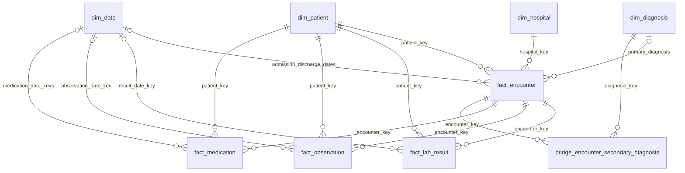

# Phase 2 warehouse architecture

MedAxis × Meridian **SortNext Project Lab simulation**. The analytical schema is FHIR-inspired but not a compliant FHIR service.

## Flow
Five source CSV files → manual pgAdmin import into five `raw` staging tables → deduplication, SQL transformations → four dimension tables and four fact tables in `warehouse` → validation queries. Source CSV import must be performed before running the warehouse loader.

## Entity relationship diagram

## Grain
`dim_patient`: one patient ID; `dim_hospital`: one site ID; `dim_diagnosis`: one ICD-10 code; `dim_date`: one day. `fact_encounter`: one unique encounter ID; `fact_lab_result`: one lab ID; `fact_observation`: one observation ID; `fact_medication`: one medication ID; `bridge_encounter_secondary_diagnosis`: one encounter-diagnosis pair.

This diagram reflects the submitted foreign-key relationships. Table DDL is in `sql/04_create_dim_tables.sql` and `sql/05_create_facts.sql`.